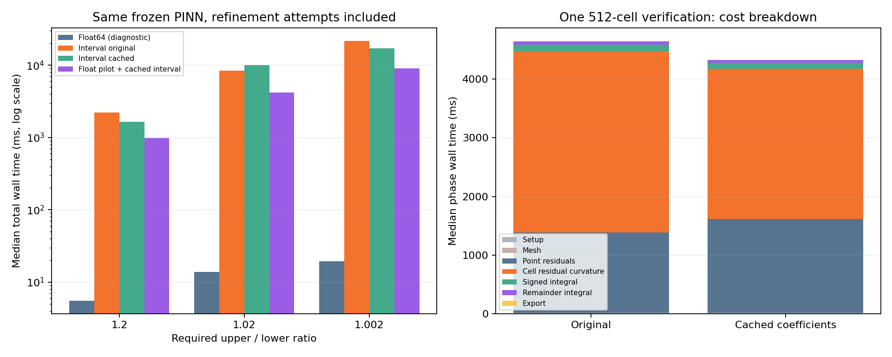

# 毕设研究日终总结：2026 年 10 月 28 日

项目：神经 PDE 求解器的后验最大误差认证  
正式仓库：https://github.com/wenmj23/neural-pde-certification  
中期报告截止：2026-11-13

本总结记录今天已经完成的讨论、文献核对、代码和实验。实验由助手在会话环境执行；学生仍需逐步理解并在自己的环境复现。今天研究已经收尾，后续尝试留到明天。

## 1. 今天最重要的进展

今天把一个一维验证器从“用残差给出较保守上界”，推进到“保留残差形状、考虑验证舍入并测量完整成本”的原型。

最有用的三个结论是：

1. **直线残差近似能显著改善高频误差的上界。**在一个已知真实最大误差的高频测试上，相同点数下的上界倍数从 11.18 降到 1.16。
2. **固定 PINN 上，加入区间舍入保障后，界仍然很紧。**1000 个区间时，认证上界约为真实连续最大误差的 1.00058 倍，前提是所声明模型和区间后端的包围性质成立。
3. **计算成本仍是明确瓶颈。**浮点版是毫秒级，当前区间版是秒级。先用浮点选网格再用区间核验减少了重复计算，样本中位数改善，但计时波动明显，也没有显示出比本例传统数值求解便宜的优势。

## 2. 研究目标与已经确认的范围

PINN 产生一个近似解，验证器评估这个给定近似解与 PDE 真解之间的最大误差。本项目重点是验证器；比较方法时保持待验证函数或网络权重固定。

目前主要研究区间 [0,1] 上的零 Dirichlet Poisson 问题。早期基线采用 f=2，真实解 x(1-x)；后来补充正弦源项、混合频率、局部窄峰等测试，并固定一个正弦源项 PINN 作为后续主案例。

用户选择优先关注整个区域的最大误差，即 L∞ 误差。对于密集网格观测、连续数学上界、考虑舍入的区间实现，记录中分别标注，避免混为同一个保证等级。

## 3. 方法为什么逐步变紧

设真实解为 u*、给定近似为 v，误差 e=v-u*，残差 r=-v''-f。相同零边界下，误差满足 -e''=r。

最初用整个区域的残差绝对值上界 ε，可得最大解误差不超过 ε/8；只检查有限点时，另用残差导数上界 M 补上 Mh/2 的漏采样余量。

进一步使用局部导数界和空间位置，可以减少保守性。再保留残差正负号，求解一个误差辅助问题 z，并用非负包络 D 兜住剩余部分，可得到

\[
\max(0,\|z\|_\infty-\|D\|_\infty)
\leq\|e\|_\infty
\leq\|z\|_\infty+\|D\|_\infty.
\]

今天针对高频误差的主要改动，是将每段残差的常数表示改为连接两端点的直线。若残差二阶导数的局部上界为 K，小区间宽度为 h，未表示部分的上界成为 Kh²/8。余量随 h² 缩小，有利于收紧估计；代价是需要更高阶导数信息。粗网格下或高阶导数特别大时，改善不一定成立。

数学条件包括误差两端为零、所需残差正则性和有效导数上界；当前网络适配器针对单隐层 tanh。上述构造借鉴经典插值误差、Green 函数和比较原理，尚不宣称首创理论结果。

## 4. 普通浮点实验结果

先前 f=2 的固定网络中，统一残差界约为网格参考误差的 52.49 倍，局部导数加空间包络约 5.87 倍，保留符号的常数残差修正约 1.034 倍。这组网络与后来的正弦主案例不同，不能把它们的数值直接当成同一实验的连续改善。

以下是在相同 1001 个残差采样点下的部分代表结果。前三行的真实最大误差数学上精确已知，最后一行以密集网格观测误差作分母。

| 对象 | 常数残差、均匀 | 直线残差、均匀 | 直线残差、自适应 |
|---|---:|---:|---:|
| 高频误差 A sin(20πx) | 11.1758 | 1.1595 | 1.1446 |
| 更高频 A sin(50πx) | 167.0031 | 7.5170 | 6.9754 |
| 中部窄峰，宽度参数 0.005 | 57.2983 | 8.3843 | 1.00487 |
| 固定正弦 PINN，k=1、seed 7 | 1.17910 | 1.000491 | 1.000487 |

可见局部加密对集中型误差很有用；全域高频振荡仍然可能得到偏松的上界。自适应网格的生成有成本，点数减少不自动意味着耗时更少。

随后又补测混合频率、靠近左右边界的多项式窄峰、残差恰好为直线的例子和零误差对照。温和混合频率的上界倍数约从 1.74 降至 1.012，较强混合频率从 23.58 降至 1.73。靠近边界的窄峰也保持有效。

一个值得继续研究的难例是：最高频项幅值仅占归一化误差的 1/128，仍可能明显增大上界。求导会放大高频项，主要保守量位于未表示残差的包络；这有助于定位后续改进方向。

## 5. 固定主案例

后续主案例为

\[
-u_*''=\pi^2\sin(\pi x),\quad u_*(0)=u_*(1)=0,
\]

真实解为 sin(πx)。冻结网络为

\[
v=x(1-x)\left[c+\sum_{j=1}^{16}a_j\tanh(w_jx+b_j)\right].
\]

采用 seed 7、Adam 训练 2000 步后的 49 个参数。选择此例是因为误差较小、已有前后对照记录；此选择不代表对所有 PINN 的统计结论。

网络、训练来源、四个验证检查点、权重哈希和基准已保存到 [固定案例目录](../cases/poisson_1d_sine_k1_seed7/README.md)。重新加载后，10001 点参考网格最大误差仍为 1.0329992292423817e-4，最大值所在网格点 x=0.5264。PyTorch 与 NumPy 的网络输出和残差交叉核对通过。

原训练未保存每一步 loss 或优化器状态，冻结推理可以复现，但不承诺跨平台从种子重训逐位一致。

## 6. 第二步：舍入与连续范围核查

残差、残差二阶导数、分段积分与 Bernstein 极值包络在区间中计算。没有在旧原型核心公式中发现漏项，但补全了结果导出：保存精确有理数端点，并将展示小数向外舍入。默认端点打印文本不能自动充当可靠的十进制上/下界。

本轮一次助手核查有 94 项检查通过，含解析最大误差配置、参数语义、防护、数值微分诊断、端点一致、连续参考包含和容差判断。检查通过不等同于底层库或整个软件已经形式化证明。

固定 PINN 在 1000 个区间下的区间证书，向外缩略为

\[
1.0322460\times10^{-4}\leq\|e\|_\infty\leq1.0336008\times10^{-4}.
\]

为了核对，另利用本例已知精确解，通过端点误差区间与 e''=-r 的插值余项，覆盖全部区间，得到更窄的连续参考范围

\[
1.0329994\times10^{-4}\leq\|e\|_\infty\leq1.0330069\times10^{-4}.
\]

参考核对与认证函数使用不同公式，但共享同一数值后端。精确解不参与验证器的构造或网格选择。该结果支持“上界约为真实连续误差的 1.00058 倍”。

当前结论针对固定二进制权重定义的实函数，考虑的是验证计算的舍入，不覆盖任意有限精度推理程序。它依赖固定 mpmath 1.3.0 所用区间运算、exp、sin、pi 的包围正确性；区间支持被官方标为实验性，尚无第三方独立审查或形式化验证。适当名称是“条件明确、考虑舍入的区间证书原型”。

## 7. 第三步：同样紧度要求下的成本

以证书自身 U/L 为停止依据，从 32 个区间翻倍，并计入失败尝试。每档每模式顺序重复 3 次，记录 wall 与 CPU 时间。下表为 wall time 中位数，计入加载、构建、缓存/预估、网格、残差和导数、积分、停止与安全端点导出；研究用真解核对和结果文件写入不计入。

| U/L 要求 | 最终区间数 | 普通浮点诊断 | 原区间版 | 浮点选网格＋缓存区间 |
|---|---:|---:|---:|---:|
| ≤1.2 | 128 | 5.53 ms | 2.22 s | 0.98 s |
| ≤1.02 | 512 | 13.73 ms | 8.42 s | 4.21 s |
| ≤1.002 | 1024 | 19.33 ms | 21.74 s | 9.09 s |

三种区间模式最终精确端点相同。浮点预估只提出网格，最后必须由区间结果独立通过停止条件；专门构造的回退检查确认，预估不够细时会继续加密。

这些样本的耗时中位数改善约 2.0–2.4 倍，但波动很大：最严格档新方案的三次范围是 8.69–33.71 秒，原版是 16.92–24.10 秒。缓存单独使用在中档也出现中位数变慢。不能把中位数改善写成稳定的加速保证；原始单次数据已保留。

阶段定位显示，在这个案例中，约 96% 的单次区间验证时间用于残差与残差二阶导数包围。后续优先优化这一环节。当前区间实现仍明显慢于浮点诊断，二者保障等级不同。

同一简单方程的普通有限差分求解，100/1000 个区间约 0.0497/0.0705 ms，参考网格误差约 8.225e-5/8.225e-7。它产生另一个近似解，并不认证这个 PINN，也不提供相同的机器级保证；不过当前结果没有展示验证比本例重新求解更便宜的优势。



## 8. 今天执行检查的规模

| 脚本/阶段 | 已执行内容 |
|---|---|
| 05 | 两种正弦频率、3 个种子、4 个训练检查点，共 24 个状态 |
| 06 | 27 个已知误差的幅值/频率/网格组合及成本对照 |
| 07 | 219 个方法—对象—网格配置 |
| 08 | 同间隙成本比较及 24 项绝对容差判断 |
| 09 | 6 组早期区间原型配置 |
| 10 | 216 个补充函数配置，24 个同间隙比较配置 |
| 11 | 固定模型重新加载、参考与基准复现 |
| 12 | 94 项检查，含 13 个解析配置与 6 个固定模型配置 |
| 13 | 36 个计时请求、阶段定位和有限差分对照，143 项检查 |

这些数字衡量不同的配置、状态或代码检查，不能相加当作独立训练实验。部分高频 PINN 训练输出本身误差很大，可以用于检验差解报告，不能作为求解效果好的证据；主案例为误差较小的 k=1 输出。

## 9. 文献与阅读状态

今天继续核对了以下原始材料的相关方法和适用范围；尚未完成论文算法的完整复现，也不表示学生已经全文精读。

- [Führer & Rojas，A posteriori analysis of neural network approximations](https://arxiv.org/abs/2507.06017)：残差有限维部分与剩余部分的共同控制，关注变分范数及求积条件。
- [Demlow、Franz、Kopteva，Maximum norm a posteriori error estimates for convection–diffusion problems](https://doi.org/10.1093/imanum/drad001)：Green 函数与加权估计、自适应；方程与总误差概念不同，不能直接套用常数。
- [Liu、Huang、Protopapas，Residual-based error bound for physics-informed neural networks](https://proceedings.mlr.press/v216/liu23b.html)：方程结构与残差构造误差界，适用方程类别需区分。
- [mpmath 区间文档](https://mpmath.readthedocs.io/en/latest/contexts.html) 与 [NIST DLMF 3.1](https://dlmf.nist.gov/3.1)：区间包围与定向舍入；实现使用固定版本并记录源码哈希。

更多既有条目保留在 [文献清单](../literature/reading_list.md)。不同论文的能量范数、L∞ 范数和假设不直接比较倍数。

## 10. 今天交付与明天起点

仓库保存脚本、配置、冻结案例、推导、文献状态、工作记录，以及选定运行的原始 JSON/CSV 和图。原始开题报告中的个人信息文件继续排除在公开提交之外。已有早期笔记和结果保留。

新克隆后的最短复现路径：

```bash
python -m pip install -r requirements-interval.txt
python scripts/14_restore_archived_results.py
python scripts/11_reproduce_frozen_case.py
```

若要重跑区间核查与成本测量，再分别运行脚本 12 和 13；二者会运行一段时间并写入新的时间戳目录。恢复脚本只拷贝并校验归档文件，不训练、不运行实验。

明天建议先由学生复现主案例，并讲清上下界、重构余项和网格选择；随后分析计时波动及区间导数求值成本，再决定下一项优化。更高阶残差重构、其他后端、更多网络和更高维 PDE 都仍是待研究项，今天没有继续扩展。

中期报告已有可整理的内容包括：问题定义、经典上界推导、直线重构对照、适用范围测试、固定案例、舍入核查和完整成本结果。新颖性、普遍有效性及效率优势仍需进一步证据。
